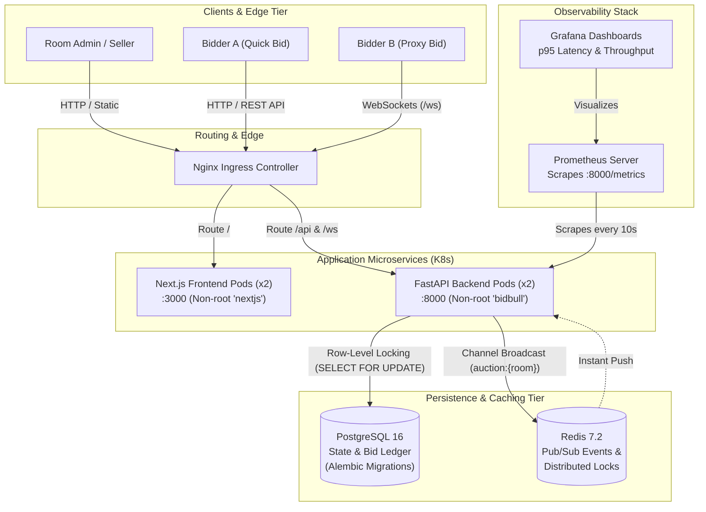
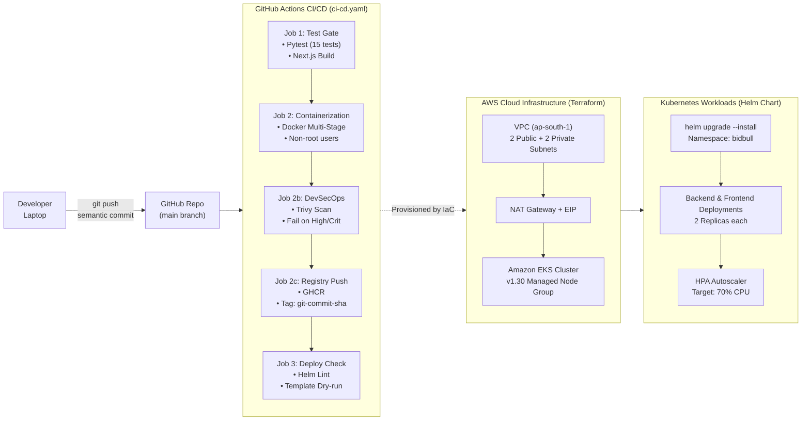
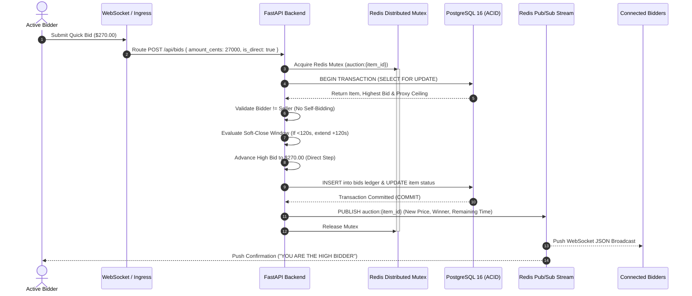
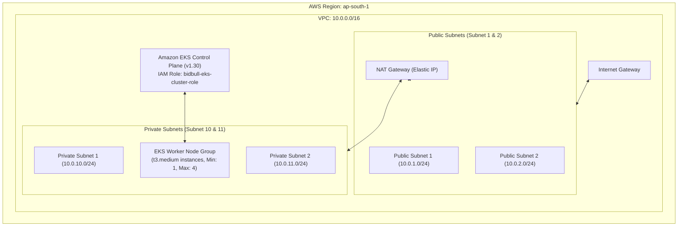
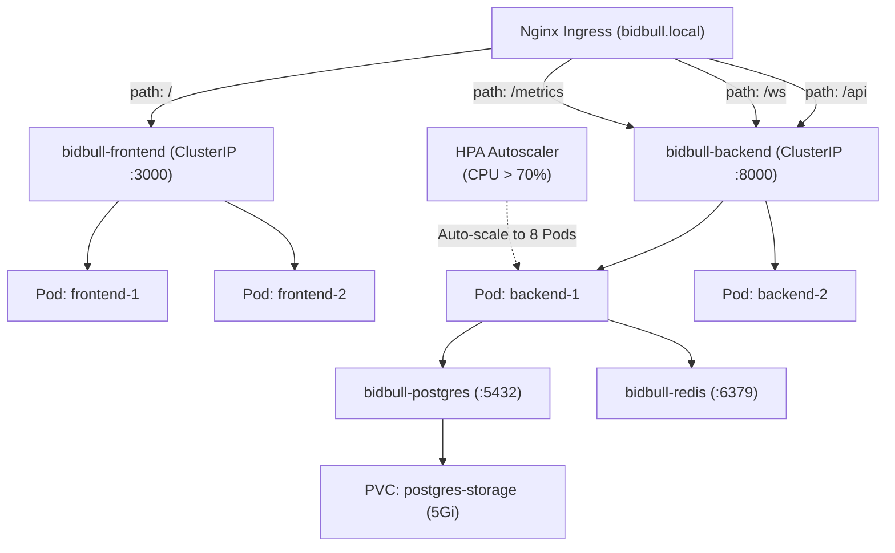
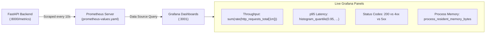

# BidBull — Architecture, DevOps Pipeline & Video Presentation Guide

A visual blueprint and presentation reference for the BidBull Real-Time Auction Platform, covering architecture design, automated CI/CD pipelines, cloud infrastructure, and video demonstration flow.

---

## 1. High-Level System Architecture

BidBull connects web bidders and room administrators to a distributed real-time backend through an ingress reverse proxy, backed by PostgreSQL for state persistence and Redis for sub-millisecond pub/sub synchronization.

---

## 2. End-to-End DevOps Lifecycle Pipeline

The complete path of code traveling from local development to a monitored, auto-scaling Kubernetes cluster on AWS.

---

## 3. Real-Time Auction & Proxy Bidding Engine Flow

How incoming quick bids and automated proxy ceiling bids are processed atomically without race conditions:

---

## 4. Terraform AWS Infrastructure Blueprint

Declarative provisioning of the underlying networking and container orchestrator in `ap-south-1`:

---

## 5. Kubernetes Helm Package & Ingress Routing

Hierarchical mapping of Kubernetes resources managed by `helm/bidbull`:

---

## 6. Observability & Monitoring Feedback Loop

Continuous scraping and metrics visualization:

---

## 7. 3-Minute Video Presentation Script

Use this timing and talking points script for recording your capstone video walkthrough:

### Scene 1: Introduction & Architecture (0:00 – 0:45)
- **Visual:** Show System Architecture Diagram (`DESIGN_AND_PIPELINE.md`).
- **Narration:**
  > *"Hello! This is BidBull, a real-time digital auction platform developed for the DevOps Engineering Capstone, satisfying all 10 modules from containerization to cloud orchestration. The application is built with Python FastAPI and Next.js, backed by PostgreSQL 16 and Redis 7.2. It features automated proxy bidding, anti-sniping soft-close timers, and live WebSocket broadcasts."*

### Scene 2: Live Application & Direct Bidding Demo (0:45 – 1:30)
- **Visual:** Open browser at `http://localhost:3000` and Swagger docs at `http://localhost:8000/docs`.
- **Narration:**
  > *"Here is the running application. We onboard as an administrator, create an isolated room, and publish an auction lot. Room creators are strictly prevented from self-bidding. Bidders can join the room, place direct quick bids which advance the auction price immediately, or set automated proxy ceilings. The UI supports both dark obsidian mode and a warm, legible light mode."*

### Scene 3: CI/CD Pipeline & DevSecOps Security Scan (1:30 – 2:15)
- **Visual:** Show `.github/workflows/ci-cd.yaml` and a GitHub Actions run.
- **Narration:**
  > *"Every push to the main branch triggers our automated GitHub Actions pipeline. First, 15 Pytest tests run against an isolated database alongside the frontend build. Second, Docker Buildx compiles multi-stage, non-root images. Aqua Security Trivy performs a DevSecOps audit, configured with exit-code 1 to fail on HIGH or CRITICAL CVEs. Once cleared, images are pushed to GHCR tagged with the exact Git commit SHA for full traceability."*

### Scene 4: Terraform IaC, Kubernetes Helm & Observability (2:15 – 3:00)
- **Visual:** Show `terraform/`, `helm/bidbull/`, and Grafana dashboard.
- **Narration:**
  > *"Our AWS infrastructure is declaratively managed with Terraform, provisioning a VPC with public/private subnets, NAT Gateway, and an EKS cluster in ap-south-1. Workloads are packaged using Helm into dual-replica deployments with Nginx Ingress and an HPA that autoscales pods on CPU spikes. Finally, Prometheus continuously scrapes our /metrics endpoint, feeding real-time throughput and p95 latency metrics into Grafana. Thank you!"*
