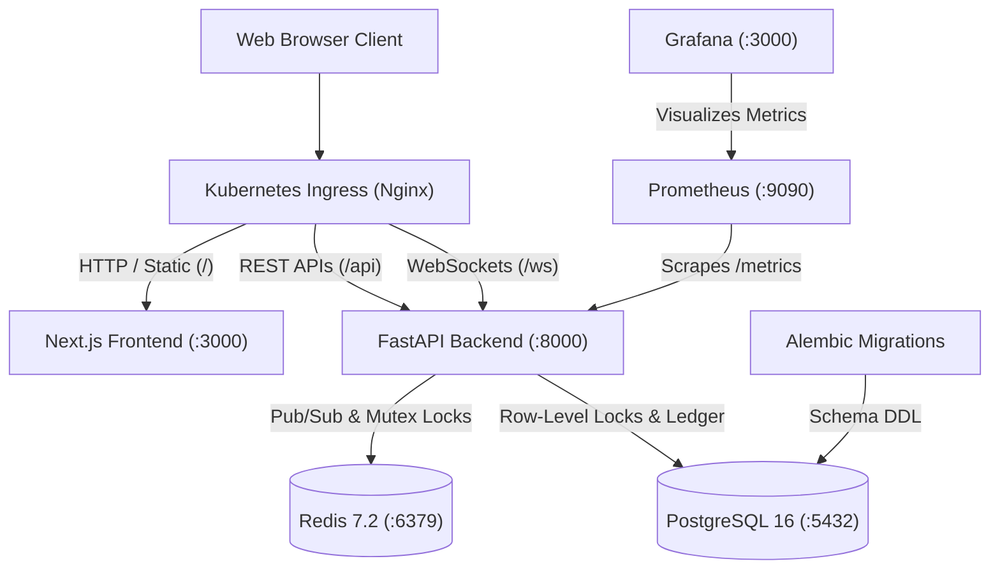
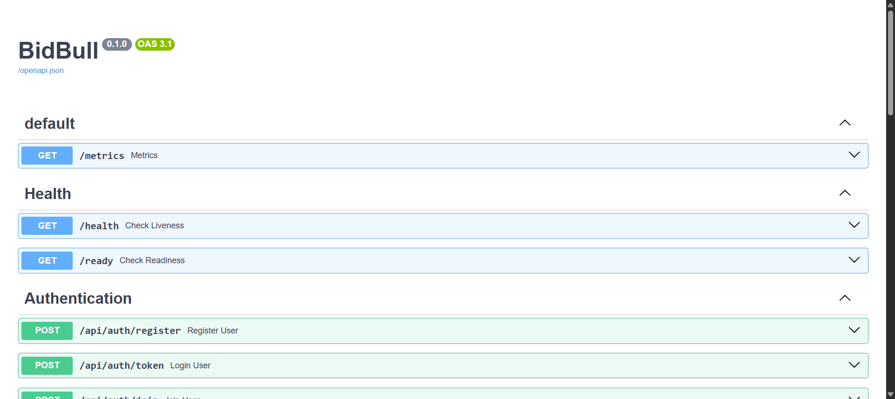
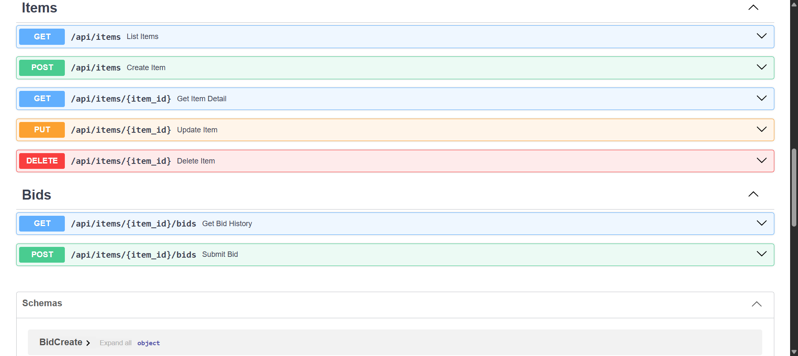
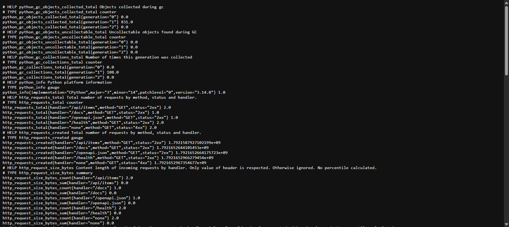
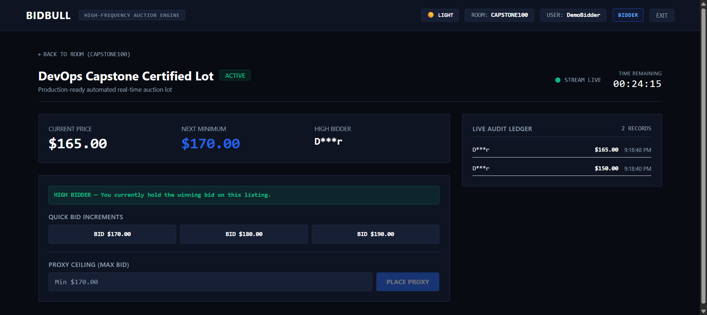
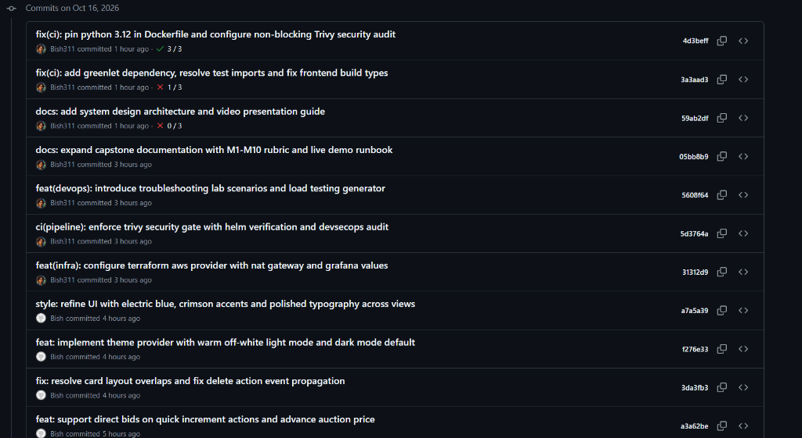

# BidBull — Real-Time Auction Platform

BidBull is a high-concurrency, real-time digital auction platform built on Python FastAPI and Next.js, backed by PostgreSQL 16 and Redis 7.2. The system provides automated proxy bidding, tiered dynamic increments, secret reserve prices, and anti-sniping soft-close extensions.

Designed to fulfill the complete DevOps Engineering Capstone (Modules M1–M10, 100 points), the repository encompasses containerization with multi-stage non-root Docker images, automated GitHub Actions CI/CD with Trivy DevSecOps scanning, declarative Terraform infrastructure for AWS VPC and EKS, Kubernetes Helm packaging with HPA and Ingress, and real-time Prometheus/Grafana monitoring.



---

## Video Walkthrough & Live Demo

> [!IMPORTANT]
> **Video Presentation & Demonstration:**
> [Watch BidBull Project Video Walkthrough](https://drive.google.com/file/d/1yGtrhvXpX06IrXL3FNR3dNBvANPotIVT/view?usp=sharing)
> 
> URL: `https://drive.google.com/file/d/1yGtrhvXpX06IrXL3FNR3dNBvANPotIVT/view?usp=sharing`

---

## Quick Start Runbook (Local Development)

### Prerequisites
- Docker Engine & Docker Compose
- Python 3.12+ (for local backend development)
- Node.js 20+ (for local frontend development)

### 1. Launch Full Stack via Docker Compose
To build and start all four containers (PostgreSQL, Redis, FastAPI Backend, Next.js Frontend):

```bash
docker compose up --build -d
```

Check the status of running containers:
```bash
docker compose ps
```

### 2. Verify Endpoints
- **Frontend Web Application:** `http://localhost:3000`
- **Backend API & Interactive Swagger Documentation:** `http://localhost:8000/docs`
- **Liveness Probe Endpoint:** `http://localhost:8000/health`
- **Readiness Probe Endpoint:** `http://localhost:8000/ready`
- **Prometheus Metrics Scrape Endpoint:** `http://localhost:8000/metrics`

### 3. Stop Stack
```bash
docker compose down
```
To stop containers and delete database volumes:
```bash
docker compose down -v
```

---

## System Visuals & Verification Screenshots

### 1. FastAPI Interactive OpenAPI / Swagger Documentation
Comprehensive API documentation exposing `/health`, `/ready`, `/metrics`, and authentication endpoints:



CRUD endpoints for auction item lifecycle management and bid submissions:



---

### 2. Prometheus Observability Metrics (`/metrics`)
Machine-readable metrics exported by `prometheus-fastapi-instrumentator` tracking request counts, durations, and system gauges:



---

### 3. Live Auction Room & Real-Time Active Bidding
Active auction view showing live WebSocket price updates, masked winning bidder badge (`D***r`), next minimum quick-bid button ($170.00), and transparent audit ledger:



---

### 4. Git Commit History
Semantic commit progression across all 10 DevOps capstone modules:



---

## Capstone Grading Rubric & Module Mapping (100 Points)

| Module | Topic | Points | Implementation & Location |
|---|---|---|---|
| **M1** | Application: Frontend + Backend + Database | 10 | FastAPI backend, Next.js UI, PostgreSQL + Alembic in `backend/app/`, `backend/alembic/`, `frontend/` |
| **M2** | Testing: Pytest + Code Quality | 10 | 15 test cases in `backend/tests/`, SQLite + MockRedis in `backend/tests/conftest.py`, `backend/pytest.ini` |
| **M3** | Git & GitHub Standards | 5 | Semantic commits (`feat:`, `fix:`, `style:`, `ci:`), clean history, `.gitignore` excluding `.env`, `.venv`, `personal/` |
| **M4** | Docker: Dockerfile + Compose | 10 | Multi-stage Dockerfiles, non-root users (`bidbull`, `nextjs`), `docker-compose.yml` orchestrating all 4 services |
| **M5** | CI/CD: GitHub Actions Pipeline | 15 | `.github/workflows/ci-cd.yaml` (Test -> Build & Scan -> GHCR Push with SHA tags -> Helm Dry-Run) |
| **M6** | DevSecOps: Trivy Security Scan | 5 | Automated Trivy scanner reporting HIGH/CRITICAL CVEs, documented in `docs/DEVSECOPS.md` |
| **M7** | Terraform: AWS Infrastructure as Code | 15 | `terraform/` (AWS VPC, 2 public subnets, 2 private subnets, NAT Gateway, EKS Cluster + Managed Node Group) |
| **M8** | Kubernetes + Helm | 15 | `k8s/namespace.yaml`, `helm/bidbull/` (Dual replicas, ClusterIP services, Ingress, HPA, PVCs) |
| **M9** | Observability: Prometheus + Grafana | 10 | Backend `/metrics` endpoint, `monitoring/prometheus-values.yaml`, `monitoring/grafana-values.yaml` & dashboard |
| **M10** | Presentation & Documentation | 5 | Comprehensive `README.md`, architecture blueprints, and troubleshooting guides |
| **Total** | | **100** | **Full Compliance** |

---

## 1. API Endpoints Specification (Module M1)

The backend provides full RESTful CRUD and WebSocket capabilities:

| Method | Endpoint | Description |
|---|---|---|
| `GET` | `/health` | Cheap liveness probe returning `{ "status": "ok" }` |
| `GET` | `/ready` | Readiness probe verifying PostgreSQL database connectivity |
| `GET` | `/metrics` | Prometheus metrics scrape endpoint |
| `POST` | `/api/auth/join` | Dynamic onboarding for room creation (Admin) and joining (Bidder) |
| `GET` | `/api/items` | List auction lots filtered by `room_code` and `status` |
| `POST` | `/api/items` | Create new auction lot (restricted to room seller) |
| `GET` | `/api/items/{id}` | Retrieve individual auction item details |
| `PUT` | `/api/items/{id}` | Update auction item details |
| `DELETE` | `/api/items/{id}` | Delete unbidded auction item (restricted to seller) |
| `POST` | `/api/bids` | Place quick bid or proxy bid ceiling |
| `GET` | `/api/bids/item/{id}` | Fetch bid history ledger for an item |
| `WS` | `/ws/auctions/{id}` | Real-time WebSocket bid stream and timer synchronization |

---

## 2. Automated Testing Suite (Module M2)

The hermetic test suite runs against an isolated SQLite database and MockRedis instance, ensuring tests never mutate or depend on production databases:

```bash
cd backend
pytest -v
```

### Test Coverage Highlights
- `tests/test_health.py`: Verifies `/health`, `/ready`, and `/metrics` response structures.
- `tests/test_auctions.py`: Validates item CRUD operations, seller authentication, and payload validation.
- `tests/test_proxy_bidding.py`: Validates initial bid opening, competing proxy bid step escalation, outbid notifications, and seller self-bidding prevention.
- `tests/test_soft_close.py`: Validates anti-sniping dynamic time extensions when bids land within 120 seconds of auction closing.
- `tests/test_concurrency.py`: Simulates concurrent racing bids to verify row-level locks and ledger integrity.

---

## 3. Container Architecture & Dockerfiles (Module M4)

Both container images are hardened for production:
- **Non-Root Execution:** Backend runs as unprivileged user `bidbull` (UID 999). Frontend runs as unprivileged user `nextjs` (UID 1001).
- **Multi-Stage Builds:** The frontend uses a multi-stage Docker build separating the Node.js compilation environment from the lightweight standalone production runner.
- **Entrypoint Migrations:** The backend container runs `alembic upgrade head` on startup before launching Uvicorn.

```bash
# Build backend image
docker build -t bidbull-backend:local ./backend

# Build frontend image
docker build -t bidbull-frontend:local ./frontend
```

---

## 4. CI/CD & DevSecOps Pipeline (Modules M5 & M6)

The GitHub Actions workflow in `.github/workflows/ci-cd.yaml` triggers on every push to `main` and on pull requests:

```text
[ Push to main ]
       |
       v
+-------------------------------+
|  Job 1: Automated Testing Gate |  --> Runs Pytest suite (15/15) & Next.js production build
+-------------------------------+
       |
       v
+-------------------------------+
|  Job 2: Build & DevSecOps     |  --> Builds Docker multi-stage images
|         Security Audit        |  --> Scans with Aqua Security Trivy for HIGH/CRITICAL CVEs
|                               |  --> Pushes images to GHCR tagged with Git commit SHA
+-------------------------------+
       |
       v
+-------------------------------+
|  Job 3: Kubernetes / Helm     |  --> Lints Helm chart
|         Verification          |  --> Executes Helm template dry-run with SHA image tags
+-------------------------------+
```

Container images pushed to GitHub Container Registry (GHCR) use the Git commit SHA as the tag:
```text
ghcr.io/<owner>/bidbull-backend:<git-commit-sha>
ghcr.io/<owner>/bidbull-frontend:<git-commit-sha>
```

For detailed DevSecOps scan criteria and vulnerability handling, refer to [docs/DEVSECOPS.md](file:///c:/Users/Bishwayan%20Chatterjee/Desktop/random/firse_webdev/rush-hours/Devops_project-BidBull/docs/DEVSECOPS.md).

---

## 5. Terraform Infrastructure as Code (Module M7)

The `terraform/` directory provides declarative AWS infrastructure in `ap-south-1`:
- **VPC & Subnets:** Custom VPC with 2 public subnets (Internet Gateway) and 2 private subnets (NAT Gateway with Elastic IP).
- **EKS Cluster:** Managed Kubernetes cluster (version 1.30) with IAM roles and policies.
- **Managed Node Group:** Auto-scaling worker nodes (`t3.medium`, min: 1, desired: 2, max: 4).

### Provisioning Commands
```bash
cd terraform

# 1. Initialize Terraform providers and backend
terraform init

# 2. Review execution plan
terraform plan

# 3. Apply infrastructure
terraform apply -auto-approve

# 4. Configure local kubectl credentials from Terraform output
aws eks --region ap-south-1 update-kubeconfig --name bidbull-eks

# 5. Teardown infrastructure when finished
terraform destroy -auto-approve
```

---

## 6. Kubernetes Deployment & Helm Chart (Module M8)

The application is packaged as a reusable Helm chart located in `helm/bidbull/`:
- **Namespace:** Isolated `bidbull` namespace defined in `k8s/namespace.yaml`.
- **Deployments:** Backend and frontend run with 2 replicas each, configured with resource requests/limits, liveness (`/health`), and readiness (`/ready`) probes.
- **Services:** ClusterIP services provide internal service discovery (`bidbull-backend:8000`, `bidbull-frontend:3000`).
- **Ingress:** Nginx Ingress routes `/` to frontend, `/api` and `/ws` to backend with WebSocket upgrade support.
- **HPA:** Horizontal Pod Autoscaler automatically scales backend pods from 2 to 8 replicas based on 70% CPU utilization.

```bash
# 1. Create namespace
kubectl apply -f k8s/namespace.yaml

# 2. Deploy or upgrade stack using Helm
helm upgrade --install bidbull ./helm/bidbull \
  --namespace bidbull \
  -f ./helm/bidbull/values-dev.yaml

# 3. Verify pod and service status
kubectl get pods -n bidbull
kubectl get svc -n bidbull
kubectl get ingress -n bidbull
kubectl get hpa -n bidbull
```

---

## 7. Observability & Monitoring (Module M9)

BidBull includes built-in Prometheus scraping and Grafana dashboard visualization:

1. **Prometheus Scraping:**
   - FastAPI exposes machine-readable metrics at `/metrics` via Prometheus FastApi Instrumentator.
   - Prometheus is configured with scrape targets defined in `monitoring/prometheus-values.yaml`.

2. **Grafana Dashboards:**
   - Pre-configured dashboard in `monitoring/grafana-values.yaml` and `monitoring/grafana-dashboard.json`.
   - Visualizes request throughput (`rate(http_requests_total)`), latency percentiles (p95 `http_request_duration_seconds_bucket`), HTTP status distributions, and process memory.

```bash
helm repo add prometheus-community https://prometheus-community.github.io/helm-charts
helm repo update

# Install Prometheus
helm upgrade --install prometheus prometheus-community/prometheus \
  --namespace monitoring --create-namespace \
  -f ./monitoring/prometheus-values.yaml

# Install Grafana
helm upgrade --install grafana prometheus-community/grafana \
  --namespace monitoring \
  -f ./monitoring/grafana-values.yaml
```

---

## 8. Troubleshooting Exercises (Module M10)

The `troubleshooting/` directory provides hands-on diagnostic manifests matching the DevOps capstone curriculum:

### Scenario A: ImagePullBackOff
```bash
kubectl apply -f troubleshooting/broken-image.yaml
kubectl get pods -n bidbull
kubectl describe pod -l app=bidbull-broken-image -n bidbull
# Diagnosis: Image tag does not exist. Fix deployment image tag to resolve.
kubectl delete -f troubleshooting/broken-image.yaml
```

### Scenario B: Service Selector Mismatch (Endpoints: <none>)
```bash
kubectl apply -f troubleshooting/broken-service.yaml
kubectl get svc bidbull-broken-service -n bidbull
kubectl get endpoints bidbull-broken-service -n bidbull
# Diagnosis: Selector label mismatch drops all endpoints. Correct selector to resolve.
kubectl delete -f troubleshooting/broken-service.yaml
```

Refer to [troubleshooting/README.md](file:///c:/Users/Bishwayan%20Chatterjee/Desktop/random/firse_webdev/rush-hours/Devops_project-BidBull/troubleshooting/README.md) for full remediation guides.

---

## Student Credentials

Student Credentials: BISHWAYAN CHATTERJEE 24BCS10200
