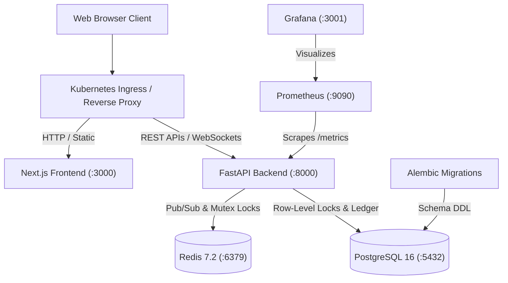

# BidBull — Real-Time Auction Platform

BidBull is a high-concurrency, real-time digital auction platform built on Python FastAPI and Next.js, backed by PostgreSQL 16 and Redis 7.2. The system provides automated proxy bidding, tiered dynamic increments, secret reserve prices, and anti-sniping soft-close extensions. Designed to fulfill the complete DevOps Engineering Capstone (Modules M1–M10, 100 points), the repository encompasses containerization with multi-stage non-root Docker images, automated GitHub Actions CI/CD with Trivy DevSecOps scanning, declarative Terraform infrastructure for AWS VPC and EKS, Kubernetes Helm packaging with HPA and Ingress, and real-time Prometheus/Grafana monitoring.



* **Core Application (M1):** FastAPI REST APIs and WebSocket stream with Next.js dashboard, backed by PostgreSQL and Alembic migrations.
* **Hermetic Testing Gate (M2):** Automated Pytest test suite covering auction lifecycles, proxy escalation, soft-close triggers, and concurrency safety.
* **Repository Standards (M3):** Clean Git history, imperative present-tense commit messages, and strict ignore rules.
* **Containerization (M4):** Multi-stage, non-root Dockerfiles for frontend and backend with complete multi-service Docker Compose orchestration.
* **CI/CD Automation (M5):** GitHub Actions pipeline executing automated tests, image compilation, and GHCR registry pushes tagged with Git commit SHA.
* **DevSecOps Scanning (M6):** Automated Trivy container vulnerability scanner failing on HIGH and CRITICAL CVE discoveries.
* **Infrastructure as Code (M7):** Modular Terraform blueprints provisioning AWS VPC, public/private subnets, and EKS managed cluster in `ap-south-1`.
* **Kubernetes Packaging (M8):** Isolated `bidbull` namespace, reusable Helm chart, dual-replica deployments, ClusterIP services, Ingress, and HPA.
* **Observability (M9):** Native Prometheus instrumentation exposing `/metrics`, scrape configuration, and Grafana dashboard visualization.
* **Documentation (M10):** Architectural specification, operational runbook, and complete verification guides.

---

## Local Development & Quickstart Runbook

### 1. Launch Multi-Service Stack via Docker Compose
Ensure Docker Desktop is running, then execute:

```bash
docker compose up --build -d
```

Verify service status:
```bash
docker compose ps
```

Access endpoints:
- **Frontend Dashboard:** `http://localhost:3000`
- **Backend API & Swagger Docs:** `http://localhost:8000/docs`
- **Health Check:** `http://localhost:8000/health`
- **Prometheus Metrics:** `http://localhost:8000/metrics`

Stop stack:
```bash
docker compose down
```

---

### 2. Run Backend Locally

```bash
cd backend
python -m venv .venv
.venv\Scripts\activate  # Windows (.venv/bin/activate on Linux/macOS)
pip install -r requirements.txt
alembic upgrade head
python ../scripts/seed_database.py
uvicorn app.main:app --reload --port 8000
```

---

### 3. Run Automated Tests

```bash
cd backend
pytest -v
```

---

### 4. Deploy with Helm on Kubernetes

```bash
kubectl apply -f k8s/namespace.yaml
helm upgrade --install bidbull ./helm/bidbull -n bidbull -f ./helm/bidbull/values-dev.yaml
kubectl get pods -n bidbull
kubectl get svc -n bidbull
```
