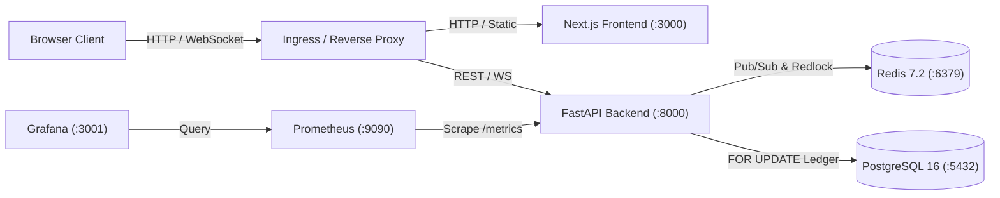

# BidBull Architecture Specification

BidBull is a high-concurrency, real-time digital auction platform engineered with Python FastAPI, Next.js, PostgreSQL 16, and Redis 7.2. The platform models competitive proxy bidding, tiered dynamic bid increments, secret reserve thresholds, and deterministic anti-sniping soft-close extensions under strict server-authoritative time coordination. Bid evaluations and ledger appends execute inside isolated transactions secured by PostgreSQL row-level locks and Redis distributed mutual exclusion, eliminating race conditions across replica pods while Redis pub/sub streams real-time state updates to connected WebSocket clients.

* **Client Clocks Have Zero Authority:** Server coordinated UTC timestamp governs all start times, soft-close windows, and closure states.
* **Strict Append-Only Ledger:** Bids are immutable records, projecting high-bidder state and price advances deterministically without mutating historical rows.
* **Integer Currency Subunits:** All monetary values are strictly represented and calculated as 64-bit integer cents to prevent floating-point inaccuracies.
* **Deterministic Anti-Sniping:** Bids placed with 120 seconds or less remaining dynamically extend the auction expiration by exactly 120 seconds.
* **Dual-Layer Concurrency Locking:** Redis distributed locks coordinate cross-pod evaluations while PostgreSQL row locks guarantee transactional serializability.
* **Non-Root Multi-Stage Containers:** Docker images enforce least-privilege security by executing runtime processes under dedicated non-root users.
* **Automated CI/CD Quality Gates:** GitHub Actions enforces test suite pass rates, Trivy vulnerability audits, and SHA-based container publishing to GHCR.
* **Declarative Infrastructure as Code:** AWS VPC and EKS infrastructure blueprints are managed through modular Terraform definitions.
* **Kubernetes Orchestration:** Helm packages deployments, ClusterIP services, Ingress routing, and Horizontal Pod Autoscalers targeting 70% CPU utilization.
* **Integrated Observability:** Prometheus scrapes operational metrics directly from FastAPI endpoints for real-time visualization in Grafana.

---

## Student Credentials

Student Credentials: BISHWAYAN CHATTERJEE 24BCS10200

